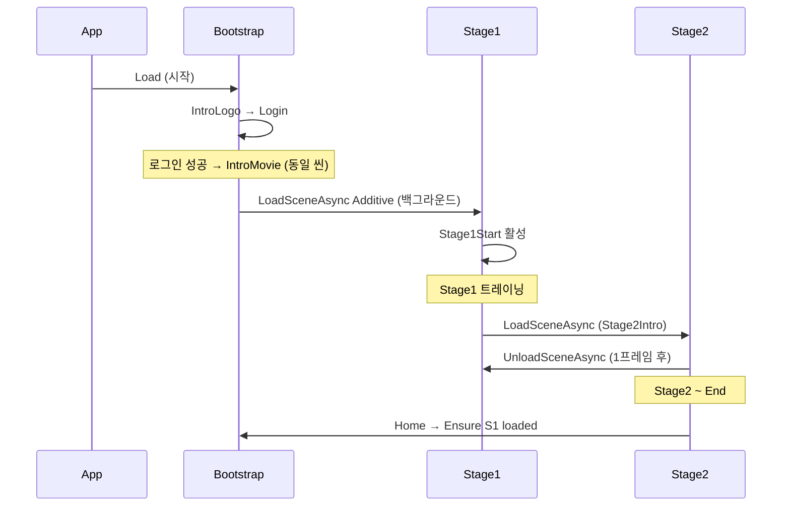

# M-Social 씬 분리 설계 (6번: Additive Scene)

> **작성:** 2026-06-15  
> **구현 완료:** 2026-06-15 (v1.17–v1.27)  
> **대상:** `M-Social_Clean` — Tab A8 2GB 시작 속도 개선  
> **전제:** Addressables 없이 **SceneManager Additive**로 1차 구현 (패키지 추가 불필요). 필요 시 2차에서 Addressables 확장.  
> **재검토 (2026-06-15):** `MSocial_Onboarding` 씬은 **불필요** → **3씬** 구조로 변경 (아래 §3·§4 참고).  
> **작업 이력:** [SESSION_HANDOFF_2026-06-14.md](./SESSION_HANDOFF_2026-06-14.md)

---

## 구현 상태 (2026-06-15)

| 항목 | 상태 | 비고 |
|------|------|------|
| `MSocial_Bootstrap.unity` | ✅ | Build Index 0 |
| `MSocial_Stage1.unity` | ✅ | Additive, Page flatten |
| `MSocial_Stage2.unity` | ✅ | Additive |
| `MSocialSceneRouter` | ✅ | Load/Unload/Reparent |
| `MSocialPageRegistry` | ✅ | PageId 조회 |
| `MSocialAppServices` | ✅ | Login DDOL 제거 |
| `MSocialStageWireup` | ✅ | userdata, EmotionSelect.scp |
| IntroMovie URL 재생 | ✅ | `MSocialIntroMoviePlayer` |
| Stage Intro URL 재생 | ✅ | `MSocialPageMoviePlayer` |
| Stage1 시나리오 영상 | 🟡 | v1.27 VideoCache — **Tab A8 재검증 대기** |
| `MainScene.unity` 빌드 제외 | ✅ | Legacy 보관 |
| Tab A8 로그인·지도 UI | ✅ | v1.19–v1.24 |
| Tab A8 영상 E2E | 🟡 | v1.27 설치 후 확인 필요 |

---

## 1. 목표 / 비목표

### 목표
- 앱 시작 시 **Bootstrap 씬만** 로드 → Login·IntroLogo까지 **&lt; 3초 체감** (Tab A8 2GB)
- 고화소 태블릿은 Stage1/2 **풀 에셋** 유지 (씬 분리만, 화질 다운그레이드 없음)
- 기존 페이지 흐름·API·CSV·영상 URL 재생 **동작 동일**
- 6번 완료 후 **3·5번(저사양 RT·Canvas)** 만 추가 보완

### 비목표 (1차)
- Addressables 원격 배포
- Imagine JPG 에셋 교체 (4번) — Stage1 씬 분리로 시작 병목은 해소, Imagine 진입 시 별도 검증
- iOS 빌드

---

## 2. 현재 구조 요약

| 항목 | 현황 |
|------|------|
| 빌드 씬 | `MainScene.unity` 1개 |
| Page 수 | 31개 (`Tag: Page`) |
| Canvas 기준 해상도 | 2800 × 1752 |
| 씬 참조 에셋 | 이미지 ~127MB, MP3 ~57MB, RT 1920×1080 × 8 |
| 페이지 전환 | `ButtonFlow` / `TimerFlow` → `GameObject` 직접 참조 |
| 전역 상태 | `Login` (userdata), `FlowManager`, `MSocialApiClient` |
| 크로스 참조 | `SceneSelect` → `Stage2Manager.FirstFrames` (Stage1 중 Stage2 데이터 사용) |

### 사용자 플로우 (확정)

```
IntroLogo ─(3s)─► LoginPage ─(로그인)─► IntroMovie ─► Stage1Start ─(3s)─► Stage1Intro ─► …
                                                                              │
                                                         FlowManager.HomePage ┘
                                                         (= Stage1Start)
```

---

## 3. 권장 아키텍처 개요 (3씬 — Onboarding 제거)

**재검토 결과:** `IntroMovie`는 Page 1개·VideoPlayer 1개 수준. 별도 `MSocial_Onboarding` 씬은  
`LoadSceneAsync` 오버헤드만 추가하고 이득이 거의 없음 → **Bootstrap에 포함**.

```
┌─────────────────────────────────────────────────────────────┐
│  MSocial_Bootstrap.unity  (항상 로드, Build Index 0)         │
│  EventSystem · Canvas · FlowManager · Background(공용)      │
│  Pages: IntroLogo, LoginPage, IntroMovie                    │
│  DDOL: Login, MSocialApiClient, MSocialMovieLibrary         │
└─────────────────────────────────────────────────────────────┘
         │ LoadSceneAsync(Additive)
         ▼
┌──────────────────────────┐   ┌──────────────────────────┐
│ MSocial_Stage1.unity     │   │ MSocial_Stage2.unity     │
│ Stage1 전체 + Task 자식  │   │ Stage2 ~ EndPage         │
└──────────────────────────┘   └──────────────────────────┘
   IntroMovie 종료 시 로드       Stage2Intro 시 로드
   Stage2 로드 후 언로드*         (홈 시 Stage1 재로드)

* 언로드는 1프레임 지연 + 저사양만 UnloadUnusedAssets
```

**IntroMovie를 Bootstrap에 둘 조건:** 씬 고정 1080p `RenderTexture` 참조 제거 → `PrepareUrl()` 런타임 RT만 사용.  
(현재 `IntroMovie`에 `FeedbackMovie.renderTexture` 1080p가 박혀 있어 그대로 두면 Bootstrap도 무거워짐)

**1차는 Addressables 대신 `SceneManager.LoadSceneAsync(..., Additive)` 사용.**  
APK에 씬 **3개** + Bootstrap, 시작 시 Bootstrap만 메모리에 올림.

---

## 4. 씬 분할 상세

### 4.1 `MSocial_Bootstrap.unity`

| 포함 | 제외 |
|------|------|
| EventSystem, Main Camera | Stage1/2 UI·오디오·Imagine |
| Canvas + **`Background`** (항상 켜진 공용 배경) | Stage1/2용 1080p RenderTexture |
| `FlowManager` | Stage1Start 이하 Page |
| `1. IntroLogo`, `2. LoginPage`, **`3. IntroMovie`** | |
| DDOL `MSocialAppServices` (신규) | |

**예상 로드:** 스프라이트 수 MB 단위, 스크립트 ~25개, RT 0개(런타임만).

### 4.2 `MSocial_Stage1.unity`

| 포함 |
|------|
| `4. Stage1Start` ~ `10. Stage1End` |
| `9-1` Positive, `9-2` Negative, `9-3` Feedback |
| Task Page: Imagine, Dance, Listen, Sing, Think, Count, Breath, Pop, PlayInstrument |
| `Stage1Manager`, `SceneSelect`, `ScenePlayer`, `EmotionSelect`, `Stage1FeedbackManager` |
| Stage1 오디오·스프라이트·Imagine JPG·Stage1용 VideoPlayer/RT |

### 4.3 `MSocial_Stage2.unity`

| 포함 |
|------|
| `11. Stage2Start` ~ `18. EndPage` |
| `Stage2Manager`, `ActSelect`, `Stage2ScenePlay`, Result/Feedback |
| Stage2 오디오·UI·영상 |

---

## 5. 신규 런타임 컴포넌트

### 5.1 `MSocialAppServices` (DontDestroyOnLoad)

```csharp
// Bootstrap에서 1회 생성
public class MSocialAppServices : MonoBehaviour
{
    public static MSocialAppServices Instance { get; private set; }
    public Login UserData { get; private set; }      // 기존 Login 컴포넌트
    public FlowManager Flow { get; private set; }
    public MSocialStageCatalog Catalog { get; private set; } // ScriptableObject
}
```

- `Login`을 LoginPage에서 **복제가 아닌 DDOL로 승격** (씬 전환 후에도 `seq`, `Stage1Progress` 유지)
- `Stage1Manager.userdata` 등 기존 필드는 `MSocialAppServices.Instance.UserData`로 점진 교체

### 5.2 `MSocialStageCatalog` (ScriptableObject)

**문제:** `SceneSelect`가 Stage1 중 `Stage2Manager.FirstFrames[]` 참조.

**해결:** 썸네일·타이틀·VideoCodes 메타를 ScriptableObject로 추출.

```
Assets/Config/MSocialStageCatalog.asset
  - Sprite[] stage1FirstFrames  (기존 FirstFrames)
  - string[] stage1Titles
  - int[] videoCodes, prv, ...
```

- Stage1·Stage2 씬 모두 동일 asset 참조 → **씬 간 Manager 참조 불필요**
- APK 용량: 스프라이트 1세트만 (중복 없음)

### 5.3 `MSocialPageId` + `MSocialPageRegistry`

```csharp
public enum MSocialPageId
{
    IntroLogo, Login, IntroMovie,
    Stage1Start, Stage1Intro, Stage1SelectMap, /* … */
    Stage2Start, /* … */ EndPage,
    Imagine, Dance, Listen /* Task pages */
}
```

- 각 Page 루트에 `MSocialPageMarker : MonoBehaviour { MSocialPageId id; }`
- 씬 로드 시 `OnSceneLoaded`에서 자동 `Register(id, gameObject)`
- `FlowManager.GoToPage` → `MSocialPageRouter.Show(MSocialPageId)` 로 교체

### 5.4 `MSocialSceneRouter`

```csharp
public enum MSocialSceneId { Bootstrap, Stage1, Stage2 }

public static class MSocialSceneRouter
{
    public static bool IsLoaded(MSocialSceneId scene);
    public static IEnumerator EnsureLoaded(MSocialSceneId scene);  // LoadSceneAsync
    public static IEnumerator Unload(MSocialSceneId scene);        // UnloadSceneAsync
    public static MSocialSceneId SceneForPage(MSocialPageId page);
}
```

**페이지 → 필수 씬 매핑 (예):**

| Page | 필요 씬 |
|------|---------|
| IntroLogo, Login, IntroMovie | Bootstrap |
| Stage1Start … Stage1End, Task* | Stage1 |
| Stage2Start … EndPage | Stage2 |

`ShowPage(id)` 내부:
1. `EnsureLoaded(SceneForPage(id))`
2. 모든 등록 Page `SetActive(false)`
3. 대상 Page `SetActive(true)`

---

## 6. 기존 스크립트 변경方針

### 6.1 `FlowManager`

| 현재 | 변경 |
|------|------|
| `FindGameObjectsWithTag("Page")` | `MSocialPageRegistry.DeactivateAll()` |
| `FirstPage` / `HomePage` GameObject | `MSocialPageId.IntroLogo` / `Stage1Start` |
| `HomeReset()` | Stage1 씬 미로드 시 `EnsureLoaded(Stage1)` 후 `Show(Stage1Start)` |

### 6.2 `ButtonFlow` / `TimerFlow`

**1차 (최소 변경):** 같은 씬 내 `NextPage` GameObject 유지.  
**씬 경계 전환만** Router 경유:

| 전환 | 처리 |
|------|------|
| Login → IntroMovie | `Router.Show(IntroMovie)` (같은 Bootstrap 씬) |
| IntroMovie → Stage1Start | `EnsureLoaded(Stage1)` → `Show(Stage1Start)` |
| Stage1 → Stage2Intro | `EnsureLoaded(Stage2)` → (지연) `Unload(Stage1)` |

`ButtonFlow.ClickNext()`에 `MSocialPageMarker` on NextPage가 다른 씬이면 Router 호출 분기.

### 6.3 `Login.cs`

- 로그인 성공 시 `GetComponent<ButtonFlow>().ClickNext()` 대신  
  `MSocialSceneRouter.ShowAfterLogin()` 코루틴 (IntroMovie 표시 + Stage1 백그라운드 로드)
- `MSocialMovieLibrary.EnsureLoaded()` → **IntroMovie 직전**으로 이동 (1번과 통합)

### 6.4 영상 (`MSocialVideoPlayerHelper`)

- Stage1/2 씬 로드 후에도 `PrepareUrl()` 사용 (기존 유지)
- 6번 + **3번**: Dance/Listen/Sing/Count도 `PrepareUrl()` 통일 (저사양 RT 자동 적용)

### 6.5 `MSocialDeviceProfile` (5번 연동)

Bootstrap `CanvasScaler`만 저사양 런타임 조정:

```csharp
// Bootstrap Canvas에서만, IsLowMemoryDevice일 때
scaler.referenceResolution = new Vector2(1280, 800);
```

Stage1/2 Canvas는 고사양 원본(2800×1752) 유지.

---

## 7. 로드 / 언로드 정책



| 이벤트 | Load | Unload | 비고 |
|--------|------|--------|------|
| 앱 시작 | Bootstrap | — | |
| 로그인 성공 | Stage1 (백그라운드, 선택) | — | IntroMovie 재생과 병렬 가능 |
| IntroMovie → Stage1 | Stage1 (미로드 시) | — | Stage1 로드 완료 후 전환 |
| Stage2Intro | Stage2 | Stage1 (지연) | `scenesDone` 등은 `Login` DDOL에 있음 |
| Home 버튼 | Stage1 (없으면) | Stage2 | `Stage1Start` |
| `Application.lowMemory` | — | — | 기존 `OnLowMemory` 유지 |

**AfterSceneLoad `UnloadUnusedAssets`:** Bootstrap만 있을 때는 **제거 또는 10초 지연** (2번).

---

## 8. Build Settings

```
0  Assets/Scenes/MSocial_Bootstrap.unity    ← active
1  Assets/Scenes/MSocial_Stage1.unity
2  Assets/Scenes/MSocial_Stage2.unity
```

- `AutomatedAndroidBuild.cs`: Build Settings 순서 갱신
- `MainScene.unity`: 마이그레이션 완료 후 제거 또는 `Legacy/MainScene.unity`로 보관

---

## 9. 마이그레이션 단계 (권장 순서)

> **2026-06-15:** Phase 0–4 핵심 구현 완료. Tab A8 영상 E2E만 재검증 대기.

### Phase 0 — 인프라 (회귀 없음)
- [x] `MSocialPageId`, `MSocialPageMarker`, `MSocialPageRegistry`
- [x] `MSocialSceneRouter` (씬 이름 상수)
- [x] `MSocialAppServices` + `MSocialStageCatalog` asset 생성
- [x] `SceneSelect` → Catalog 참조로 전환

### Phase 1 — Bootstrap 분리
- [x] `MSocial_Bootstrap.unity` 생성 (IntroLogo, LoginPage, IntroMovie, Background, FlowManager)
- [x] Login DDOL **제거** (Canvas UI 유지)
- [x] Build Index 0 교체

### Phase 2 — Stage1 분리
- [x] `MSocial_Stage1.unity` 추출
- [x] 로그인 후 Stage1 additive + Page flatten
- [x] Stage1 지도·시나리오 선택 UI (v1.24 Canvas 수정)

### Phase 3 — Stage2 분리
- [x] `MSocial_Stage2.unity` 추출
- [x] Stage2Intro / Home / End 플로우
- [x] `MainScene.unity` 빌드에서 제외 → `Legacy/`

### Phase 4 — 정리 + 영상
- [x] `PrepareUrl()` / `MSocialVideoCache` 통일 (v1.25–v1.27)
- [x] Bootstrap Canvas 저사양 2800×1752 (v1.24)
- [x] `Test-MSocialPreBuild.ps1` / FullVerification 갱신
- [ ] Tab A8 영상 전수 E2E (**v1.27 재검증 대기**)

### Phase 5 (선택) — Addressables
- com.unity.addressables 추가
- Stage1/2를 AssetBundle화, Bootstrap만 로컬
- 원격 MP4·콘텐츠 업데이트 필요 시만

---

## 10. 전수 테스트 체크리스트

### 시작 / 로그인
- [ ] Cold start → IntroLogo 3초(저사양 0.5초) → Login
- [ ] ID/PW 터치 반응 (Tab A8)
- [ ] 로그인 API 성공/실패/신규가입
- [ ] Test / admin 계정 `playNum`

### Bootstrap / IntroMovie
- [ ] IntroMovie 재생 (StreamingAssets URL)
- [ ] 영상 실패 시 앱 멈춤 없음

### Stage1
- [ ] Stage1Start → Intro → SelectMap → SelectScene → Watch
- [ ] 6카테고리 × 시나리오 영상
- [ ] Task: Imagine, Dance, Listen, Sing, Think, Count, Breath…
- [ ] Positive / Negative / Feedback
- [ ] Stage1End → Stage2Intro 전환
- [ ] CSV 업로드 (`userdata.logUpload`)

### Stage2
- [ ] Select → Watch → ActSelect
- [ ] Result Positive/Negative → Feedback → EndPage

### 공통
- [ ] Home → Stage1Start (Stage2에서)
- [ ] Info 팝업
- [ ] 앱 종료
- [ ] 메모리: Tab A8 로그인 화면 터치 정상
- [ ] 고사양: Imagine·영상 화질 기존과 동일

---

## 11. 리스크 / 완화

| 리스크 | 완화 |
|--------|------|
| 씬 경계 `NextPage` 참조 깨짐 | Router + PageId; 씬 경계만 Router |
| `Login` 참조 null | DDOL + AppServices 단일 진입점 |
| Stage1 로드 중 멈춤 | Async + 로딩 오버레이 (Bootstrap Canvas 최상위) |
| 언로드 후 Home 실패 | Home 시 `EnsureLoaded(Stage1)` |
| Unity 6 Additive UI | Page를 Bootstrap Canvas 하위로 **재부착**하거나, 씬마다 Canvas 두고 Sort Order 통일 |
| 검증 스크립트 실패 | Build scene 목록·필수 오브젝트 assert 추가 |

### UI 부착 전략 (중요)

**권장:** Bootstrap에 **단일 Canvas** + `MSocialPageContainer` (RectTransform).  
Additive 씬의 Page 루트를 로드 후 `SetParent(PageContainer, false)`로 merge.

- EventSystem 1개 유지
- CanvasScaler 1개 (5번 저사양 조정 지점)
- 기존 Page 앵커(2801×1752) 유지 가능

---

## 12. 예상 효과

| 구간 | 현재 (MainScene) | 분리 후 (Bootstrap만) |
|------|------------------|-------------------------|
| 시작 시 이미지 참조 | ~127MB | ~5–15MB (Login+Logo) |
| 시작 시 MP3 | ~57MB | 0 |
| 시작 시 1080p RT | 8개 | 0 |
| MonoBehaviour Awake | ~360 | ~30 |

Stage1/2는 해당 진입 시 로드 → **로그인·터치 병목 제거**가 목표.

---

## 13. 6번 완료 후 남는 작업

| # | 필요 여부 |
|---|-----------|
| 1 movie_index Login 제거 | ✅ IntroMovie 직전으로 통합 |
| 2 AfterSceneLoad GC | ✅ Bootstrap만이면 제거/지연 |
| 3 저사양 RT | ✅ PrepareUrl 통일 시 Stage1 로드 시 적용 |
| 4 Imagine JPG | ⏸ Stage1 진입 속도 보고 결정 |
| 5 저사양 Canvas | ✅ Bootstrap만 |
| 6 씬 분리 | ✅ 본 설계 |

---

## 14. MainScene 내부 재검토 (중복·불필요 Page)

| 항목 | 결론 |
|------|------|
| `Assets/Scenes/*.unity` | **MainScene 1개만** — 씬 파일 중복 없음 |
| `13. Stage2Select` 2개 | **중복 Page 아님** — 자식 `Image`가 부모와 동일 이름 (리네임 권장) |
| `Stage1MainScene` vs `8. Stage1WatchScene` | **동일 GameObject** (`SceneSelect` 참조명) |
| `10. Stage1End` | **미사용 Page 아님** — `Stage1Manager.LastPop` 팝업 |
| `7. Stage1SelectScene` | Scene 버튼 `UnityEvent`로 활성화 — 필요 |
| `Background` (Canvas 1번 자식) | **항상 Active** 공용 배경 — Bootstrap에 포함 |
| Task (Imagine 등) | `9-3. Stage1Feedback` / `15. ActSelect` **자식** — Stage1/2 씬에 부모와 함께 이동 |
| `Page` 태그 | Image·Button·Main Camera 등 **10종 오탈자** — 루트 Page만 태그 (FlowManager 버그 예방) |

**삭제 가능한 Page/씬: 없음.** 정리는 이름·태그·RT 참조 위주.

---

## 15. 롤백

- `MainScene.unity` 보관 + Build Settings 한 줄 복원
- Router 클래스는 `#if MSOCIAL_LEGACY_SCENE`으로 비활성화 가능
- Phase별 브랜치: `feature/scene-split-phase-1` …
