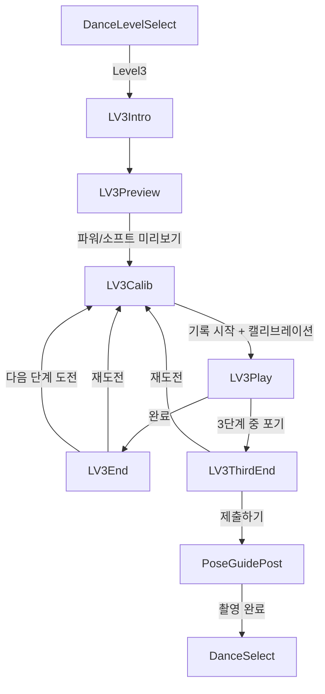

# M-Body 세션 작업 기록 (2026-07-02 — LV3 댄스 스타 디버깅)

> **프로젝트:** `C:\project\Unity_Projects\MBody_Revised_Clean`  
> **Unity:** 6000.3.18f1 / 6000.4.1f1  
> **패키지:** `com.CAU.MBody`  
> **대상 기기:** Galaxy Tab A8 SM-T290 (`R9WR611YAAJ`)  
> **이전 세션:** [`SESSION_HANDOFF_2026-06-28b.md`](./SESSION_HANDOFF_2026-06-28b.md)

---

## 0. 요약

| 구분 | 결과 |
|------|------|
| LV3Calib 웹캠 미리보기 (하얀 화면) | ✅ 수정 |
| LV3Play 오른쪽 빨간 배경 (웹캠 미표시) | ✅ 수정 |
| LV3 다음 단계 도전 — 노트 겹침·동일 음악 | ✅ 수정 |
| LV3 제출 후 PoseGuidePost 멈춤 | ✅ 수정 (DanceSelect 복귀) |
| APK 빌드·태블릿 설치 | ✅ 완료 (~37.83 MB) |

---

## 1. LV3 댄스 스타 — 전체 씬 흐름



### 씬별 역할

| 씬 | 스크립트 | 역할 |
|----|----------|------|
| **LV3Intro** | — | 3단계 댄스 스타 안내 |
| **LV3Preview** | `DancePreviewIcon` | 선택 댄스 파워/소프트 영상 미리보기 |
| **LV3Calib** | `SmallPoseGuide`, `DanceModePage` | 웹캠 캘리브레이션, "기록을 시작합니다" |
| **LV3Play** | `NoteManager`, `DanceStarManager`, `DanceModePage` | 리듬 댄스 + BGM, 왼쪽 노트, 오른쪽 웹캠 |
| **LV3End** | `LV3EndTextBar`, `DanceStarManager` | 1·2단계 후 재도전 / 다음 단계 도전 |
| **LV3ThirdEnd** | — | 3단계 종료 후 재도전 / 제출하기 |
| **PoseGuidePost** | `PoseGuide` | 댄스 후 자세 촬영 (15초 카운트다운) |
| **DanceSelect** | — | 댄스 선택 화면 복귀 |

### ButtonFlow 전환 (검증 통과)

| From | To | 트리거 |
|------|-----|--------|
| LV3Intro | LV3Preview | Next |
| LV3Preview | LV3Calib | Next |
| LV3Calib | LV3Play | Next |
| LV3Play | LV3End | Next |
| LV3Play | LV3ThirdEnd | Return |
| LV3End | LV3Calib | 재도전 / 다음 단계 도전 |
| LV3ThirdEnd | LV3Calib | Restart |
| LV3ThirdEnd | PoseGuidePost | 제출하기 (Next) |

---

## 2. GameLevel별 동작 (의도된 설계)

`DanceStarManager.GameLevel` (1~3)이 LV3Play 난이도를 결정한다.

| GameLevel | 왼쪽 NoteBox 표시 | BGM (수정 후) | 기타 |
|-----------|-------------------|---------------|------|
| **1단계** | 선택 댄스 **사람 동작 사진** (T1, danceNum별) | `bgms[기본인덱스]` | 노트 0.25× 스케일 |
| **2단계** | **파워/소프트 네모 아이콘** (T2, 2종) | `bgms[기본인덱스 + 1]` | 노트 0.35× 스케일 |
| **3단계** | 단일 아이콘 (T3) | `bgms[기본인덱스 + 2]` | `VideoCaptureCam` 녹화 시작 |

> **참고:** 2단계에서 사람 사진 대신 네모 아이콘이 나오는 것은 **원본 설계**이다.  
> 1단계 = 동작 사진, 2단계 = 파워/소프트 구분 아이콘, 3단계 = 자유 춤 + 녹화.

### 댄스별 BGM 기본 인덱스 (`NoteManager` 내 `ds` 배열)

| danceNum | 댄스명 | 기본 BGM 인덱스 | 1단계 | 2단계 | 3단계 |
|----------|--------|-----------------|-------|-------|-------|
| 1 | 날아봐 | 1 | bgms[1] | bgms[2] | bgms[3] |
| 2 | 날봐줘 | 4 | bgms[4] | bgms[5] | bgms[6] |
| 3 | 디스코 | 6 | bgms[6] | bgms[6]* | bgms[6]* |
| 4 | 연주 | 3 | bgms[3] | bgms[4] | bgms[5] |
| 5 | 스웨그 | 0 | bgms[0] | bgms[1] | bgms[2] |
| 6 | (6번째) | 2 | bgms[2] | bgms[3] | bgms[4] |

\* `bgms` 배열 길이(7) 초과 시 `Clamp`로 마지막 인덱스 사용.

### LV3End 버튼 동작

| 버튼 | 호출 | 결과 |
|------|------|------|
| **재도전** | `DanceStarManager.RestartLevel()` | 같은 GameLevel 유지 → LV3Calib |
| **다음 단계 도전** | `DanceStarManager.NextLevel()` | GameLevel 1→2→3 증가 → LV3Calib |

---

## 3. 발견된 이슈와 수정 내역

### 3-1. LV3Calib — 웹캠 미리보기 안 됨 (하얀 화면)

**증상:** "기록을 시작합니다" 버튼만 보이고 카메라 미리보기 없음.

**원인:**
- 웹캠 준비 전 Record 버튼 클릭 가능 (`diag.log`: Record clicked → webcam not ready)
- `SmallPoseGuide.OnDisable`에서 `ReleaseBodyCapture()` 호출로 웹캠 해제
- `smallPlate` 씬 참조 null (런타임 `fm.smallPlate`로 보완 필요)

**수정 (`SmallPoseGuide.cs`, `BodyResourceLifecycle.cs`):**
- `EnsureSmallPlateWebcamReady()` 공통 헬퍼 추가
- 웹캠 준비 전 Record 버튼 비활성화
- `OnDisable`에서 `ReleaseBodyCapture()` 제거 (원본과 동일)

---

### 3-2. LV3Play — 오른쪽 빨간 배경만 표시

**증상:** 음악·왼쪽은 동작하나 오른쪽은 빨간 배경만 보임.

**원인:**
- `LV3Play` 진입 시 `DanceModePage`가 `ReleaseBodyCapture()` 호출
- 오른쪽 영역은 `FlowManager.smallPlate` 위치의 **본인 웹캠 미러**

**수정:**
- `DanceModePage.cs`: `LV3Play`를 카메라 유지 페이지에 추가
- `NoteManager.cs`: `OnEnable` 시 `EnsureSmallPlateWebcamReady()` 후 게임 시작

---

### 3-3. 다음 단계 도전 — 노트 겹침·동일 음악

**증상:** 2단계 진입 후 왼쪽에 네모 버튼만 겹쳐 흘러감, 음악이 1단계와 동일.

**원인:**
- BGM 선택이 `danceNum`만 사용, `GameLevel` 미반영
- 2단계 T2 스프라이트에 `SetNativeSize`/스케일 미적용 → 크기 과대·겹침
- NoteBox 프레임 Image(`183473254`) 비활성 상태
- `NextLevel()` 후 웹캠 재배치 없음

**수정:**

| 파일 | 변경 |
|------|------|
| `NoteManager.cs` | BGM `기본인덱스 + (GameLevel-1)`, 노트 프레임 활성화, `ApplyNoteSpriteSize()` |
| `DanceStarManager.cs` | `SyncNoteTypes()`, `PrepareForCalib()` (웹캠·smallPlate 재설정) |

---

### 3-4. 제출하기 — PoseGuidePost 후 멈춤

**증상:** 제출 → 사람 형태 촬영 씬 → 다음 진행 없이 멈춤.

**원인:**
- `PoseGuidePost` Next 버튼이 페이지만 `SetActive(false)` 하고 **다음 씬 이동 없음** (원본 MBody.unity도 동일)
- `DanceModePage`가 `PoseGuidePost`에서 카메라 해제

**수정 (`PoseGuide.cs`, `DanceModePage.cs`):**
- `PoseGuidePost`를 카메라 유지 페이지에 추가
- 촬영 완료 후 Next 클릭 시 `SceneFlowNavigator.ShowOnly(DanceSelect)` 자동 이동

---

## 4. 수정된 파일 목록 (이번 세션 누적)

| 파일 | 변경 요약 |
|------|-----------|
| `Assets/SmallPoseGuide.cs` | 웹캠 준비 게이트, OnDisable 시 캡처 유지 |
| `Assets/Script/BodyResourceLifecycle.cs` | `ConfigureSmallPlateWebcam`, `EnsureSmallPlateWebcamReady` |
| `Assets/Script/DanceModePage.cs` | `LV3Play`, `PoseGuidePost`, `LV4Game` 카메라 페이지 |
| `Assets/NoteManager.cs` | 웹캠 복원, 단계별 BGM, 노트 크기·프레임 |
| `Assets/DanceStarManager.cs` | `SyncNoteTypes`, `PrepareForCalib` |
| `Assets/PoseGuide.cs` | PoseGuidePost 완료 → DanceSelect 이동 |

### 이전 세션에서 완료된 관련 수정 (참고)

| 파일 | 내용 |
|------|------|
| `Assets/LV2Left.cs` | `dm.level` 사용, 플레이 버튼 연결 |
| `Assets/NoteManager.cs` | `dm` 런타임 탐색 |
| `Assets/FlowManager.cs` | ScenePageVideoDriver 연동 |
| `Assets/Scenes/MBodyDancePack.unity` | LV2 VideoScreen, 버튼 순서 |

---

## 5. 주요 파일·페이지 매핑

| 페이지 | GameObject / ID | 스크립트 |
|--------|-----------------|----------|
| LV3Calib | `1814674352` | `SmallPoseGuide`, `DanceModePage` |
| LV3Play | `415438938` | `DanceStarManager`, `NoteManager`, `DanceModePage` |
| LV3Preview | `274194515` | `DancePreviewIcon` |
| LV3End | `1421767221` | `ButtonFlow` → LV3Calib |
| LV3ThirdEnd | `1135638092` | 제출 → PoseGuidePost |
| PoseGuidePost | `1408046590` | `PoseGuide` |
| PoseGuide (참고) | — | `PoseGuide.cs` (웹캠 정상 동작 참고 구현) |

### 웹캠·UI 위치

| 요소 | 위치 (anchoredPosition) | 용도 |
|------|-------------------------|------|
| `FlowManager.smallPlate` | x:337, y:-182 | 오른쪽 웹캠 영역 기준 |
| LV3Calib TextBox (2) | x:-1010 | 왼쪽 안내 프레임 |
| LV3Play NoteBox | x:-1010 | 왼쪽 노트 레인 |

---

## 6. 빌드·설치·로그

### 빌드

```powershell
powershell -ExecutionPolicy Bypass -File "C:\project\Unity_Projects\MBody_Revised_Clean\scripts\build-android.ps1"
```

- 출력: `Build\Android\MBody-latest-stable.apk` (~37.83 MB)
- OBB: `Build\Android\main.1.com.CAU.MBody.obb` (~696.52 MB)

### 설치

```powershell
powershell -ExecutionPolicy Bypass -File "C:\project\Unity_Projects\MBody_Revised_Clean\scripts\install-apk-obb.ps1"
```

### diag.log (기기)

```
/sdcard/Android/data/com.CAU.MBody/files/MBody/diag.log
```

확인 키워드:

```
[SmallPoseGuide]
[NoteManager]
[DanceStar]
[BodyCapture]
[PoseGuide]
[ButtonFlow]
```

---

## 7. 테스트 체크리스트

- [ ] LV3Calib: 페이지 진입 시 오른쪽 웹캠 미리보기
- [ ] LV3Calib: 웹캠 준비 전 Record 버튼 비활성(회색)
- [ ] LV3Play: 왼쪽 노트 + 오른쪽 웹캠 + BGM
- [ ] LV3End → 다음 단계 도전: **다른 음악**, 2단계 네모 아이콘 노트
- [ ] LV3ThirdEnd → 제출하기 → PoseGuidePost 촬영 → **DanceSelect** 복귀
- [ ] 3단계 Return → LV3ThirdEnd 표시

---

## 8. 미해결·추가 검토 사항

| 항목 | 설명 |
|------|------|
| 2단계 왼쪽 UI | 네모 아이콘은 설계상 정상. 사람 사진 유지가 필요하면 별도 요구 |
| BGM 배열 경계 | danceNum=3 등에서 3단계 BGM 인덱스가 배열 끝으로 clamp될 수 있음 |
| 중복 PoseGuidePost | 씬에 `PoseGuidePost` 오브젝트 2개 존재 (1408046590, 2063746713) — 제출 경로는 1408046590 |
| LV3End 씬 버튼 | 원본은 Next Level 시 `WebCamObject` 직접 enable; 팩 씬은 로컬 Image 참조로 깨져 있음 → 코드 `PrepareForCalib()`로 대체 |
| Git 커밋 | 사용자 미요청 — 커밋 안 함 |

---

## 9. 환경 정보

| 항목 | 값 |
|------|-----|
| Unity | 6000.3.18f1 (빌드), 6000.4.1f1 |
| 디바이스 | Galaxy Tab A8 `R9WR611YAAJ` |
| adb | `%LOCALAPPDATA%\Android\Sdk\platform-tools\adb.exe` |
| 작업 브랜치 | (미커밋) |

---

*문서 생성: 2026-07-02 — LV3 댄스 스타 디버깅 세션 handoff*
