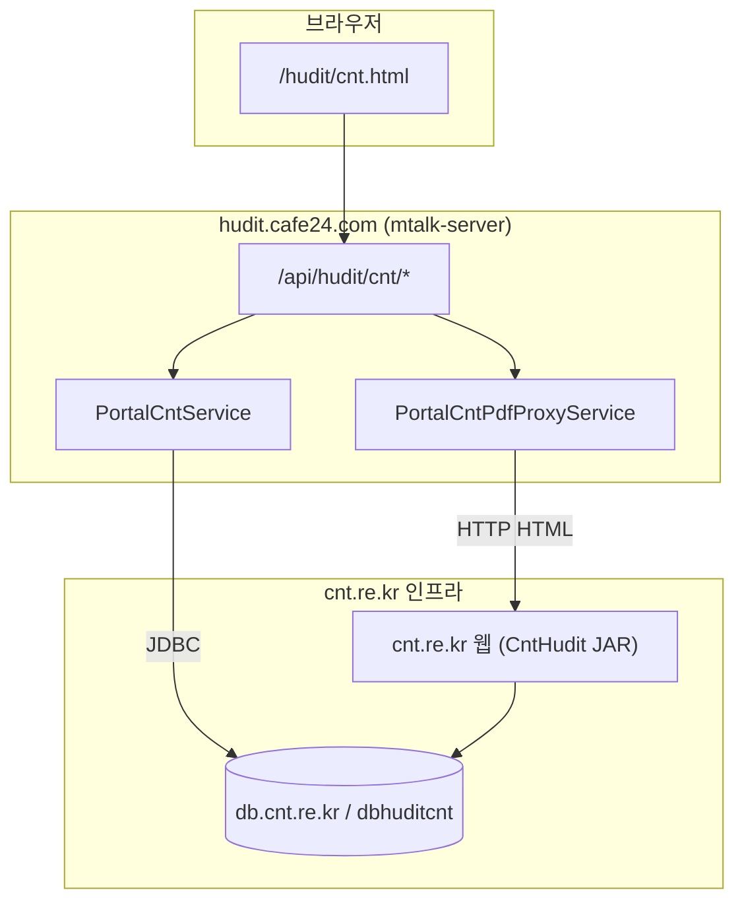

# HUDIT CNT 작업 종합 정리 (2026-07-15)

> 작성일: 2026-07-15  
> 대상: `hudit.cafe24.com` HUDIT 포털 + CNT 연동  
> 저장소: [nicecog/mtalk](https://github.com/nicecog/mtalk) (`mtalk-server/`)  
> 원칙: **cnt.re.kr 레거시 JAR/템플릿은 수정하지 않음** — DB 직접 조회·쓰기 + PDF HTML 프록시

---

## 1. 시스템 구성 요약

| 구분 | 호스트 | 역할 |
|------|--------|------|
| HUDIT 통합 서버 | `hudit.cafe24.com` (VPS `1.234.65.46:8080`) | Spring Boot `mtalk-server`, HUDIT 포털, MTalk 4종 API |
| CNT MySQL | `db.cnt.re.kr:3306` / `dbhuditcnt` | 센터·회원·게임·해석 데이터 |
| CNT 레거시 웹 | `http://cnt.re.kr` | PDF HTML 원본, 일부 관리 화면, 외부 링크 대상 |



---

## 2. 소스·Git 저장소

| 항목 | 경로 |
|------|------|
| GitHub | `https://github.com/nicecog/mtalk` |
| 로컬 Git 루트 | `F:\PROJECT\Unity_Projects\_mtalk-git-sync` |
| 개발 진입점 (Junction) | `F:\PROJECT\Unity_Projects\mtalk` → `_mtalk-git-sync/mtalk-server` |
| CNT 레거시 (참고용, 미배포) | `F:\hudit\cnt\cnthudit` |

- 코드 수정은 `mtalk/`에서 하면 Git 추적 경로 `mtalk-server/`에 반영됩니다.
- `.env.cafe24`, `.env.gabia-cnt`는 **gitignore** — VPS SSH·DB 비밀번호 포함.

---

## 3. CNT 연동 3가지 방식

| 방식 | 대상 | HUDIT에서 하는 일 |
|------|------|-------------------|
| **DB 직접** | `dbhuditcnt` | 센터·회원 조회, 센터 생성·수정, 회원 일괄 생성, 분석 SELECT |
| **HTTP 프록시** | `cnt.re.kr` PDF HTML | `pdf4th` HTML + CSS/이미지 중계 (`/api/hudit/cnt/pdf-assets/**`) |
| **외부 링크** | 레거시 미구현 기능 | 결과 관리, 해석 관리 등 (`GET /cnt/config` URL) |

### 읽기/쓰기 범위 (2026-07-15 기준)

| 데이터 | HUDIT | cnt.re.kr |
|--------|-------|-----------|
| 센터 조회 | DB 직접 | DB 직접 |
| **센터 생성** | **HUDIT 모달 + POST API** | 레거시 create 화면 |
| **센터 수정** (명·노출·검사대) | **HUDIT 상세 + PUT API** | edit 화면 (목록 링크는 `[회원생성]`) |
| 회원 조회·일괄 생성 | DB 직접 | DB 직접 |
| 게임 검사 데이터 | DB SELECT (분석) | 레거시 UI 입력 |
| PDF | HTML 프록시 | HTML 원본 |

---

## 4. 2026-07-15 작업 타임라인

| 순서 | 작업 | 커밋 | 배포 |
|------|------|------|------|
| 1 | HUDIT 센터 생성 (cnt.re.kr 외부 링크 → 내부 DB INSERT) | `a5480f3` | ✅ |
| 2 | 센터 생성 시 **검사 대(구분)** `max_session` 추가 | `d1eee24` | ✅ |
| 3 | 센터 상세에서 **조직명·노출·검사대** 수정 | `d1eee24` | ✅ |
| 4 | 조직명 변경 DB 영향도 분석 (운영 DB 직접 확인) | — | — |

---

## 5. 센터 생성 (HUDIT)

### 5.1 배경

- 기존: `cnt.html`의 **+ Create New Center** → `cnt.re.kr/cnt/admin/centers/create` 외부 이동
- 변경: HUDIT 내부 모달 + `POST /api/hudit/cnt/centers` → `cnt_center` INSERT

### 5.2 입력 필드

| # | 항목 | DB 컬럼 | 비고 |
|---|------|---------|------|
| 1 | 센터 ID | `center_id` | 필수, 중복 불가, 최대 20자 |
| 2 | 센터 명 (조직명) | `center_nm` | 필수, 최대 200자 |
| 3 | 노출 여부 | `open_yn` | Y/N, 기본 Y |
| 4 | 검사 대(구분) | `max_session` | 0~3, 기본 0 |

### 5.3 검사 대(구분) 옵션 (cnt.re.kr과 동일)

| value | 표시 |
|-------|------|
| `0` | 그룹 대상을 선택해주세요 |
| `1` | 유아 |
| `2` | 성인 |
| `3` | 3~4세용 |

### 5.4 센터 ID 명명 규칙

- **권고:** `K/E/M/H/U` + 영문 2자 (예: `KMB`)
  - K=어린이집, E=초등, M=중, H=고, U=대
- **강제 아님:** 권고 형식과 다르면 UI에 경고만 표시, 생성 가능
- **차단:** 빈 ID, 기존 `center_id` 중복

### 5.5 API

```
POST /api/hudit/cnt/centers
Content-Type: application/json

{
  "centerId": "KMB",
  "centerNm": "테스트센터",
  "openYn": "Y",
  "maxSession": "1"
}
```

---

## 6. 센터 수정 (HUDIT)

### 6.1 배경

- cnt.re.kr edit 화면(`/cnt/admin/centers/{no}/edit`)에는 센터명·노출 수정이 있으나, 목록 링크가 `[회원생성]`이라 찾기 어려움
- 검사 대(구분)는 cnt.re.kr **생성 화면에만** 있고 edit에는 없음
- HUDIT는 센터 상세에서 **3가지를 한 번에** 수정 가능

### 6.2 수정 가능 필드

| 항목 | DB 컬럼 | 변경 가능 |
|------|---------|-----------|
| 센터 ID | `center_id` | ❌ readonly (FK·회원 ID 규칙과 연결) |
| 센터 명 (조직명) | `center_nm` | ✅ |
| 노출 여부 | `open_yn` | ✅ |
| 검사 대(구분) | `max_session` | ✅ |

### 6.3 API

```
PUT /api/hudit/cnt/centers/{no}
Content-Type: application/json

{
  "centerNm": "변경된 조직명",
  "openYn": "Y",
  "maxSession": "2"
}
```

---

## 7. 조직명(center_nm) 변경 영향도 분석

> 2026-07-15 운영 DB(`dbhuditcnt`) 직접 조회 결과

### 7.1 결론

**조직명만 변경하면 영향도는 낮습니다.** 회원·검사 데이터는 `center_id`로 연결되며, 이름은 `cnt_center`에만 저장됩니다.

### 7.2 `cnt_center` 스키마

```sql
CREATE TABLE cnt_center (
  no           bigint AUTO_INCREMENT PRIMARY KEY,
  center_id    varchar(20) NOT NULL UNIQUE,
  center_nm    varchar(200),
  open_yn      varchar(1),
  audit_dt     datetime NOT NULL DEFAULT now(),
  max_session  varchar(255)
);
```

### 7.3 `cnt_member` 관계

- `center_id` → FK → `cnt_center.center_id`
- `center_name` 컬럼 존재하나 **전 회원 10,580건 모두 NULL (미사용)**
- 게임/결과 테이블(`cnt_emotion`, `cnt_nback` 등)은 **`user_id`만** 보유, `center_nm` 없음

### 7.4 변경 시 영향

| 대상 | 영향 |
|------|------|
| `cnt_center.center_nm` | 직접 변경 |
| `cnt_member` | 없음 (`center_id` FK 유지) |
| 게임/검사 결과 | 없음 |
| PDF·목록 표시 | JOIN으로 **자동 반영** |

### 7.5 주의: center_id 변경은 고위험

- `cnt_member.center_id` FK
- 회원 ID 규칙 `{center_id}{3자리}`
- 기존 데이터 전체와의 연결

---

## 8. cnt.re.kr vs HUDIT 기능 비교

| 기능 | cnt.re.kr | HUDIT (2026-07-15) |
|------|-----------|---------------------|
| 센터 목록 | ✅ | ✅ |
| 센터 생성 | create 화면 (4항목) | 모달 (4항목, ID 규칙 권고만) |
| 센터명 수정 | edit 화면 (목록 `[회원생성]`) | 상세 **센터 정보 저장** |
| 노출 수정 | edit 화면 | 상세 **센터 정보 저장** |
| 검사대 수정 | ❌ (생성 시만) | ✅ 상세에서 수정 가능 |
| 회원 일괄 생성 | edit 화면 | 센터 상세 |
| PDF | 레거시 HTML | HTML 프록시 + 일괄 ZIP |

---

## 9. 변경 파일 (2026-07-15)

### 백엔드

| 파일 | 변경 |
|------|------|
| `PortalCntCreateCenterRequest.java` | `maxSession` 추가, ID/명 길이 검증 (20/200) |
| `PortalCntUpdateCenterRequest.java` | `maxSession` 추가, `@Valid` 검증 |
| `PortalCntCenterResponse.java` | `maxSession` 필드 추가 |
| `PortalCntService.java` | create/update INSERT·UPDATE에 `max_session` |
| `PortalApiController.java` | create/update API, `@Valid` |
| `PortalApiExceptionHandler.java` | validation 400 응답 (이전 커밋) |

### 프론트

| 파일 | 변경 |
|------|------|
| `cnt.html` | 생성 모달 + 상세 `select#detail-max-session`, 저장 시 `maxSession` 전송 |

---

## 10. Git 커밋 이력

| 커밋 | 메시지 | 내용 |
|------|--------|------|
| `a5480f3` | Add HUDIT CNT center creation via direct DB insert. | 센터 생성 API·모달·중복 검사 |
| `d1eee24` | Add HUDIT CNT center session group and editable center fields. | max_session 생성/수정, 조직명·노출 수정 강화 |

```powershell
cd F:\PROJECT\Unity_Projects\_mtalk-git-sync
git log -3 --oneline
git push origin main
```

---

## 11. 배포

### 11.1 사전 조건

- `F:\PROJECT\Unity_Projects\mtalk\.env.cafe24` (git 제외)
  - `CAFE24_VPS_HOST`, `CAFE24_VPS_PASSWORD`, `CAFE24_VPS_HOSTKEY` 등
  - `CNT_DB_*`, `MTALK_DB_*` 앱 설정

### 11.2 배포 명령

```powershell
cd F:\PROJECT\Unity_Projects\mtalk\scripts
.\Deploy-Cafe24Vps.ps1
```

동작: Maven 빌드 → SCP `/opt/mtalk` → Docker compose build/up → health 확인

### 11.3 배포 이력 (2026-07-15)

| 시각 | 결과 | 비고 |
|------|------|------|
| 1차 | ✅ | 센터 생성 (`a5480f3`) |
| 2차 | ✅ (1회 네트워크 오류 후 재시도) | max_session·센터 수정 (`d1eee24`) |

### 11.4 운영 확인

```powershell
curl http://hudit.cafe24.com:8080/health
.\Verify-HuditPortal.ps1   # 선택
```

브라우저: https://hudit.cafe24.com → HUDIT 로그인 → **CNT**

1. **+ 센터 생성** → 모달 4항목
2. 센터 **회원생성** → 상세 → 조직명·노출·검사대 수정 → **센터 정보 저장**

---

## 12. REST API (센터 관련)

기본 prefix: `/api/hudit` (HUDIT 포털 세션 필요)

| Method | Path | 설명 |
|--------|------|------|
| POST | `/cnt/centers` | 센터 생성 (centerId, centerNm, openYn, maxSession) |
| GET | `/cnt/centers/{no}` | 센터 상세 |
| PUT | `/cnt/centers/{no}` | 센터 수정 (centerNm, openYn, maxSession) |

### DTO

**PortalCntCreateCenterRequest**

- `centerId` (필수, max 20)
- `centerNm` (필수, max 200)
- `openYn` (Y|N, 기본 Y)
- `maxSession` (0|1|2|3, 기본 0)

**PortalCntUpdateCenterRequest**

- `centerNm` (필수, max 200)
- `openYn` (Y|N)
- `maxSession` (0|1|2|3)

**PortalCntCenterResponse**

- `no`, `centerId`, `centerNm`, `openYn`, `maxSession`, `sessionLabel`, `auditDt`

---

## 13. 제약·알려진 사항

1. **cnt.re.kr JAR/템플릿 미수정** — HUDIT만 확장
2. **center_id 변경 불가** — FK·회원 ID 체계
3. **center_name (member)** — DB 컬럼 있으나 미사용, 조직명 변경 시 동기화 불필요
4. **`.env.cafe24` 유실 주의** — Git junction 동기화 시 gitignore 파일은 별도 백업
5. **배포 네트워크** — SCP 중단 시 재실행 (`Deploy-Cafe24Vps.ps1`)

---

## 14. 관련 문서

| 문서 | 설명 |
|------|------|
| `docs/HUDIT_CNT_IMPLEMENTATION_WORKLOG.md` | CNT 전체 구현·PDF·API 상세 |
| `docs/CAFE24_VPS_DEPLOYMENT_REPORT.md` | VPS 배포 검증 |
| `docs/CAFE24_HUDIT_SESSION_SUMMARY.md` | CAFE24 VPS·MTalk 종합 (상위) |
| **본 문서** | `docs/HUDIT_CNT_SESSION_20260715.md` |

| URL | 용도 |
|-----|------|
| http://hudit.cafe24.com:8080/hudit/cnt | HUDIT CNT 관리 |
| http://cnt.re.kr/cnt/admin/centers/create | 레거시 센터 생성 (참고) |
| http://cnt.re.kr/cnt/admin/centers/{no}/edit | 레거시 센터 edit (참고) |

---

*본 문서는 2026-07-15 HUDIT CNT 센터 생성·수정·DB 영향도 분석·GitHub·VPS 배포 작업을 종합 정리한 것입니다.*
